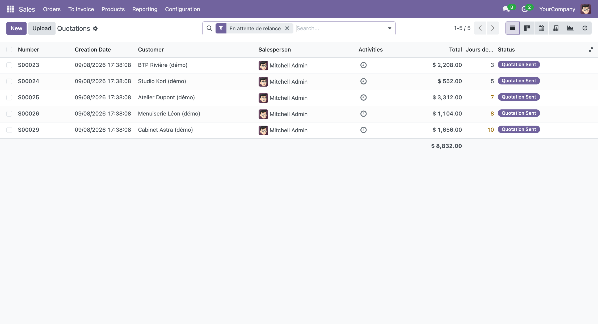
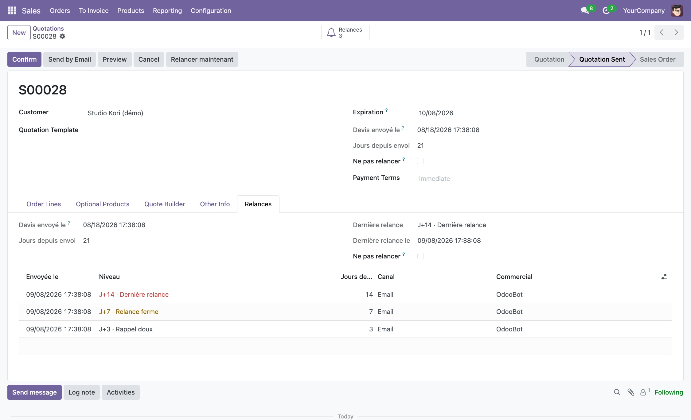
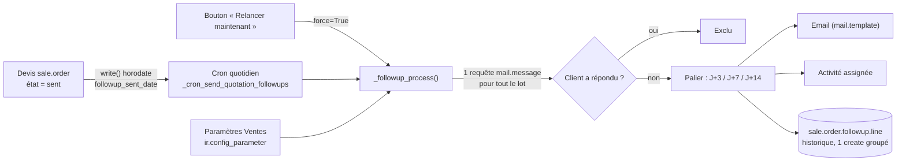

# Sale Quotation Follow-up — relances automatiques de devis (Odoo 18)

> **EN —** Odoo 18 module that automatically follows up on quotations left unanswered (day 3 / 7 / 14, escalating tone) by email and/or assigned activity, with a per-quote history.
> **Status:** portfolio demo, exercised on Odoo 18.0 (official `odoo:18` image); not used in production. No automated tests yet.
> **Source:** [github.com/seder2610](https://github.com/seder2610)

**FR —** Module Odoo 18 qui relance automatiquement et progressivement (J+3 / J+7 / J+14, ton croissant) les devis restés sans réponse, par email et/ou activité assignée, avec historique sur le devis.

---

## Problème → Solution → Pour qui

**Problème.** Les devis envoyés restent sans suite et personne ne relance au bon moment ; relancer à la main est irrégulier, et un devis déjà répondu ne doit surtout pas être relancé.

**Solution.** Un cron quotidien détecte les devis à l'état « Devis envoyé », calcule leur ancienneté, ignore ceux où le client a déjà répondu par email, et envoie le palier atteint (rappel doux, relance ferme, dernière relance). Chaque relance est tracée sur le devis.

**Pour qui.** Équipes commerciales sous Odoo 18 (module Ventes) qui veulent un suivi de devis régulier sans outil externe.

| | |
|---|---|
| Version | `18.0.1.0.0` |
| Dépend de | `sale_management` |
| Licence | LGPL-3 |

---

## Résultat

Exécution réelle sur une base jetable avec les **données de démonstration** du module (10 devis, clients fictifs en `example.com`), cron lancé deux fois de suite :

| Passage du cron | Lignes d'historique |
|---|---|
| avant (démo chargée) | 8 |
| après le 1er passage | 11 (+3 relances envoyées, ex. S00027 « last », S00025 « firm », S00023 « reminder ») |
| après le 2e passage | 11 (aucun doublon : le cron est ré-entrant) |

Captures (données de démonstration) :

---

## Architecture

---

## Prérequis

| Élément | Valeur |
|---|---|
| Odoo | **18.0** (testé sur l'image officielle `odoo:18`) |
| Module Odoo dépendant | `sale_management` |
| Intégration externe | aucune ; un serveur de courrier sortant est nécessaire pour l'envoi réel des emails |

---

## Installation

1. Placer `sale_quote_followup/` dans un chemin de vos `addons_path` Odoo 18.
2. Redémarrer Odoo.
3. Installer : `odoo -d <DB> -i sale_quote_followup --stop-after-init` (avec données de démo si la base les inclut).
4. Configurer un serveur de courrier sortant (*Paramètres ▸ Technique ▸ Serveurs de messagerie sortante*) pour un envoi réel.
5. *Ventes ▸ Configuration ▸ Paramètres ▸ « Relances automatiques des devis »* : régler délais, canal, responsable des activités.
6. Vérifier le cron « Devis : relances automatiques progressives » (*Paramètres ▸ Technique ▸ Actions planifiées*).
7. Test à la demande : `odoo shell -d <DB> --no-http -c "env['sale.order']._cron_send_quotation_followups(); env.cr.commit()"`.

---

## Configuration

| Paramètre | Clé `ir.config_parameter` | Défaut |
|---|---|---|
| Rappel doux (jours) | `sale_quote_followup.reminder_days` | `3` |
| Relance ferme (jours) | `sale_quote_followup.firm_days` | `7` |
| Dernière relance (jours) | `sale_quote_followup.last_days` | `14` |
| Canal | `sale_quote_followup.channel` | `email` (`email` / `activity` / `both`) |
| Responsable des activités | `sale_quote_followup.activity_user_id` | `<YOUR_ODOO_USER>` (à choisir) |

Destinataire des emails : l'adresse du client sur le devis ; expéditeur : commercial ou société. Aucun secret ni adresse réelle dans le dépôt (les emails de démo sont en `example.com`).

---

## Fonctionnalités

- **Cron quotidien** « Devis : relances automatiques progressives » qui scanne les
  devis à l'état `sent`, envoyés depuis plus de *N* jours et sans réponse.
- **Champ calculé « Jours depuis envoi »** (`followup_days_since_sent`), affiché dans
  la liste des devis et sur le formulaire, avec code couleur (orange ≥ J+7, rouge ≥ J+14).
- **Filtre « En attente de relance »** dans la vue liste des devis (+ « Sans relance
  depuis J+7 », « Relance envoyée », « Relance désactivée » et un regroupement
  « Niveau de relance »).
- **Relance à ton progressif :**
  | Palier | Défaut | Ton |
  |--------|--------|-----|
  | `reminder` | **J+3** | Rappel doux |
  | `firm` | **J+7** | Relance ferme |
  | `last` | **J+14** | Dernière relance |
- **Canal configurable** (Paramètres › Ventes) : email via `mail.template`,
  activité assignée, ou les deux.
- **Historique horodaté** de chaque relance sur le devis : onglet *Relances*,
  bouton statistique, modèle `sale.order.followup.line`, menu
  *Ventes › Devis › Relances de devis*.
- Bouton **« Relancer maintenant »** sur le devis (envoie le palier suivant) et
  case **« Ne pas relancer »** pour exclure un devis.

## Règles métier

- La date d'envoi (`followup_sent_date`) est horodatée automatiquement au passage
  à l'état `sent` (et remise à zéro si le devis repasse en brouillon).
- Le cron envoie **le palier le plus élevé atteint** par l'ancienneté du devis et
  non encore envoyé (un devis oublié jusqu'à J+7 reçoit directement la relance ferme).
  Le bouton manuel, lui, envoie le **palier suivant** dans l'ordre.
- Un devis est considéré **« avec réponse »** (donc exclu du cron) s'il a reçu un
  email entrant (`mail.message` de type *email*) d'un contact du client depuis la
  date d'envoi. Le devis confirmé (`state = sale`) sort mécaniquement du périmètre.
- Le filtre liste « En attente de relance » est un **indicateur** (état `sent`,
  ≥ J+3, non bloqué, dernier palier ≠ *dernière relance*) ; l'exclusion fine
  « sans réponse » est faite par le cron au moment de l'envoi.

## Performances

Le moteur de relance est **borné en requêtes** quel que soit le nombre de devis :
une `search`, un `fetch` de préchargement, une seule requête `mail.message` pour
la détection des réponses, et **un seul `create`** groupé pour tout l'historique
(pas de N+1). Le seul coût par devis est l'envoi de l'email lui‑même, inhérent.

---

## Statut et limites

**Statut.** Démonstration / portfolio, non utilisé en production. Installé et exercé sur Odoo 18.0 (image officielle `odoo:18`) ; les résultats ci-dessus viennent d'une exécution réelle.

**Limites.**

- **Aucun test automatisé** dans le dépôt ; vérification manuelle (shell Odoo, cron appelé à la main).
- La détection de réponse ne considère que les **emails entrants** (`mail.message` de type email) d'un contact du client ; un appel ou un message sur un autre canal n'est pas vu.
- Les emails sont mis en file (`force_send=False`) : sans serveur sortant configuré, ils restent en file d'attente.
- Le filtre « En attente de relance » est un indicateur ; l'exclusion « sans réponse » n'est faite qu'au moment de l'envoi par le cron.
- Les gabarits email sont rédigés en français.

---

## Licence

LGPL-3 — voir [LICENSE](LICENSE).
